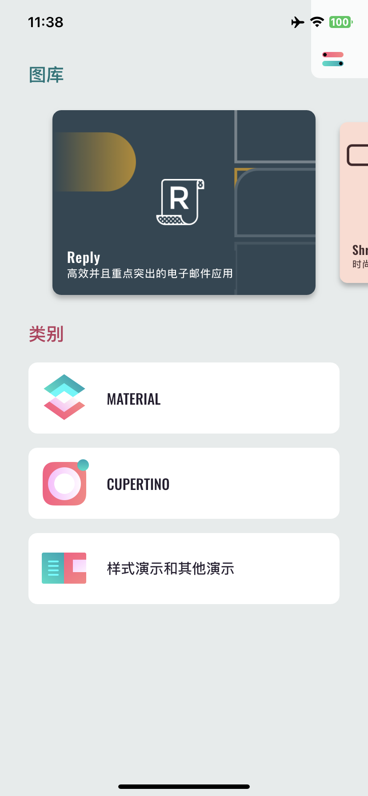

<div align="center">

# Flutter Gallery

**English** · [简体中文](README_zh.md)

Material and Cupertino widgets, motion and theming, plus four complete sample apps (Reply, Shrine, Rally, Crane) in one Flutter app.<br/>
Kept building on current Flutter and ready to run on iPhone from Windows, Linux or macOS with [KXBuild](https://github.com/kxbuild/kxbuild).



</div>

## What's inside

| Section | Content |
|---|---|
| **Material** | App bar, banner, bottom app bar, bottom navigation, bottom sheet, buttons, cards, chips, data table, dialogs, dividers, grid lists, lists, menus, pickers, progress indicators, selection controls, sliders, snackbars, tabs, text fields, tooltips |
| **Cupertino** | Activity indicator, alerts and action sheets, buttons, context menu, navigation bar, pickers, scrollbar, segmented control, slider, switch, tab bar, text field, search field |
| **Style and other** | Colors, typography, motion (container transform, shared axis, fade through, fade), two-pane layout |
| **Studies** | Reply (email), Shrine (retail), Rally (personal finance), Crane (travel) |

The app follows the system light / dark mode and ships translations for 100+ locales.

## Run it on an iPhone

You need the Flutter SDK on `PATH`, KXBuild installed ([install guide](https://github.com/kxbuild/kxbuild#-install)) and [signing](https://github.com/kxbuild/kxbuild#-signing) set up.

```shell
git clone https://github.com/kxbuild/flutter-gallery.git
cd flutter-gallery

# First build only: fetch Dart packages and prepare the iOS project
kxbuild doctor .
cd ios
pod install
cd ..

# Build Release, install on the USB-connected iPhone and launch it
kxbuild run ios/Runner.xcworkspace -s Runner -c Release
```

The bundle identifier is `com.kxbuild.fluttergallery`. If your provisioning profile does not cover it, switch to one of yours:

```shell
kxbuild project add-setting --project ios/Runner.xcodeproj --target Runner --key PRODUCT_BUNDLE_IDENTIFIER --value com.yourcompany.gallery
```

### Hot reload in VS Code

Install the KXBuild extension and the Dart extension, open this folder, pick the iPhone in the KXBuild view and press F5. Save a `.dart` file and the change appears on the phone with the screen state kept. Breakpoints work in Dart and in the native code under `ios/Runner`.

## Changes from the original

This repository continues [flutter/gallery](https://github.com/flutter/gallery), which the Flutter team has archived. Changes:

- Localizations are generated into `lib/l10n` (current Flutter no longer has the `flutter_gen` synthetic package).
- `BottomAppBarTheme` → `BottomAppBarThemeData` for the current Material library.
- The iOS project was regenerated with the current `flutter create`, keeping the original app icon.
- Firebase hosting and the original release workflows were removed.

## Related repositories

- [**KXBuild**](https://github.com/kxbuild/kxbuild): build, run and publish iOS apps from Windows, Linux or macOS, on the command line or in VS Code
- [SwiftUI Gallery](https://github.com/kxbuild/swift-gallery): 15 SwiftUI demos: controls, lists, animation, gestures, Swift Charts, MapKit, SwiftData
- [UIKit Gallery (Objective-C)](https://github.com/kxbuild/objc-gallery): 14 UIKit demos in Objective-C, every view built in code
- [React Native Gallery](https://github.com/kxbuild/react-native-gallery): 16 demos of React Native's built-in components and APIs
- [Expo Gallery](https://github.com/kxbuild/expo-gallery): 22 Expo SDK modules: camera, sensors, location, SQLite and more
- [Godot Gallery](https://github.com/kxbuild/godot-gallery): 10 Godot 4 demos exported to iOS
- [Unity Gallery](https://github.com/kxbuild/unity-gallery): 10 Unity 6 demos exported to iOS
- [KXBuild App Templates](https://github.com/kxbuild/kxbuild-app-templates): Project and target templates for `kxbuild project create` and `add-target`

## License

BSD 3-Clause, same as the original. See [LICENSE](LICENSE). Flutter and the related logos are trademarks of Google LLC.
