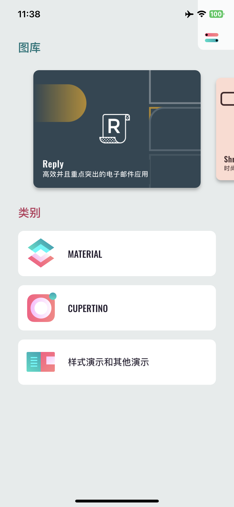

<div align="center">

# Flutter Gallery

[English](README.md) · **简体中文**

一个 Flutter 应用里集中展示 Material 与 Cupertino 组件、动效和主题，外加 Reply、Shrine、Rally、Crane 四个完整示例应用。<br/>
已适配当前版本的 Flutter，在 Windows、Linux、macOS 上用 [KXBuild](https://github.com/kxbuild/kxbuild) 即可编译并安装到 iPhone 上运行。



</div>

## 包含内容

| 分类 | 内容 |
|---|---|
| **Material** | 应用栏、横幅、底部应用栏、底部导航、底部面板、按钮、卡片、纸片、数据表格、对话框、分隔线、网格列表、列表、菜单、选择器、进度指示器、选择控件、滑块、提示条、标签页、文本框、工具提示 |
| **Cupertino** | 活动指示器、提醒与操作表、按钮、上下文菜单、导航栏、选择器、滚动条、分段控件、滑块、开关、标签栏、文本框、搜索框 |
| **样式与其他** | 颜色、字体排版、动效（容器变换、共享轴、淡入淡出切换、淡入淡出）、双窗格布局 |
| **示例应用** | Reply（邮件）、Shrine（电商）、Rally（个人理财）、Crane（旅行） |

应用跟随系统的浅色 / 深色模式，内置 100 多种语言的翻译。

## 在 iPhone 上运行

准备：Flutter SDK 已加入 `PATH`，已安装 KXBuild（[安装说明](https://github.com/kxbuild/kxbuild/blob/main/README_zh.md)），并配置好[签名](https://github.com/kxbuild/kxbuild/blob/main/README_zh.md)。

```shell
git clone https://github.com/kxbuild/flutter-gallery.git
cd flutter-gallery

# 仅首次编译需要：拉取 Dart 依赖并准备 iOS 工程
kxbuild doctor .
cd ios
pod install
cd ..

# 编译 Release，安装到 USB 连接的 iPhone 并启动
kxbuild run ios/Runner.xcworkspace -s Runner -c Release
```

Bundle ID 是 `com.kxbuild.fluttergallery`。如果你的描述文件不包含它，换成你自己的：

```shell
kxbuild project add-setting --project ios/Runner.xcodeproj --target Runner --key PRODUCT_BUNDLE_IDENTIFIER --value com.yourcompany.gallery
```

### 在 VS Code 里热重载

安装 KXBuild 扩展和 Dart 扩展，打开本目录，在 KXBuild 视图里选中 iPhone 后按 F5。保存 `.dart` 文件，改动立即出现在手机上，界面状态保持不变。Dart 代码和 `ios/Runner` 下的原生代码都可以打断点。

## 相对原项目的改动

本仓库延续自 [flutter/gallery](https://github.com/flutter/gallery)，该仓库已被 Flutter 团队归档。改动如下：

- 本地化代码生成到 `lib/l10n`（当前 Flutter 已去掉 `flutter_gen` 合成包）。
- 按当前 Material 库把 `BottomAppBarTheme` 改为 `BottomAppBarThemeData`。
- 用当前版本的 `flutter create` 重新生成 iOS 工程，保留原应用图标。
- 去掉了 Firebase 托管配置和原项目的发布流程。

## 相关仓库

- [**KXBuild**](https://github.com/kxbuild/kxbuild)：在 Windows、Linux、macOS 上编译、运行、发布 iOS App 的命令行工具和 VS Code 插件
- [SwiftUI Gallery](https://github.com/kxbuild/swift-gallery)：15 个 SwiftUI 示例：控件、列表、动画、手势、Swift Charts、MapKit、SwiftData
- [UIKit Gallery（Objective-C）](https://github.com/kxbuild/objc-gallery)：14 个 Objective-C 编写的 UIKit 示例，所有视图都在代码里创建
- [React Native Gallery](https://github.com/kxbuild/react-native-gallery)：16 个 React Native 内置组件与 API 示例
- [Expo Gallery](https://github.com/kxbuild/expo-gallery)：22 个 Expo SDK 模块：相机、传感器、定位、SQLite 等
- [Godot Gallery](https://github.com/kxbuild/godot-gallery)：10 个 Godot 4 示例，导出为 iOS 工程
- [Unity Gallery](https://github.com/kxbuild/unity-gallery)：10 个 Unity 6 示例，导出为 iOS 工程
- [KXBuild 应用模板](https://github.com/kxbuild/kxbuild-app-templates)：`kxbuild project create` 和 `add-target` 使用的项目与 target 模板，欢迎贡献

## 许可证

与原项目相同，采用 BSD 3-Clause，见 [LICENSE](LICENSE)。Flutter 及相关标志是 Google LLC 的商标。
